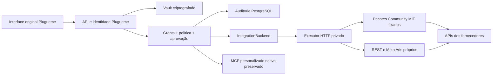

# Integrações internas do Plugueme

## Decisão

Executar os pacotes MIT Community do Activepieces em um serviço próprio, mantendo uma interface de backend substituível. Não instalar seu servidor/UI completos nesta etapa. O Plugueme já possui autenticação, Vault, grants, aprovação, auditoria, PostgreSQL e execução durável; duplicá-los num segundo produto adicionaria custo e duas autoridades de autorização.

`server/src/integrations/backend.ts` define `IntegrationBackend`: listar ferramentas e executar uma ação. O adaptador HTTP não conhece classes/pacotes do Activepieces. `integration://<connector>` é uma referência interna de catálogo, nunca um endereço HTTP fornecido pelo modelo. Outro executor que implemente o contrato pode substituir este serviço sem trocar a interface, os grants ou as contas.

## Fluxo e segurança

1. O administrador habilita o conector pela página original de integrações. A lista é obtida no executor e persistida no store original de ferramentas. Apenas ações revisadas são anunciadas.
2. A pessoa conecta OAuth Google na interface original, usando o cliente próprio configurado no Plugueme. Para tokens/API Keys, um formulário na mesma página salva sua própria chave. A chave não entra em URL nem cache de consultas; o formulário limpa o campo após salvar.
3. `mcp_user_credentials` aponta para um segredo criptografado do Vault por pessoa/conector. Não é a credencial de todos os usuários. Nenhuma migration foi necessária. `person-key` é uma fonte explícita de credencial e não um falso OAuth. A resposta de gravação informa `verified:false`.
4. O funcionário recebe grants originais por ferramenta. O store aplica identidade, grants, política, aprovação e auditoria antes da execução. A mesma fila/retomada independente já validada para MCP continua responsável por decisões humanas.
5. No momento da chamada, o servidor lê a chave pessoal ou renova o token Google sob os locks originais; envia somente o access token necessário ao executor. O executor não recebe refresh tokens, chave mestra do Vault, acesso ao PostgreSQL ou cookies de usuário.
6. Cada operação de pacote roda em subprocesso Bun descartável com ambiente mínimo, sem argumentos contendo segredos. Timeout de 25 s encerra o processo. Até quatro operações concorrem; excesso responde 429. Ações de escrita com resultado incerto não devem ser repetidas automaticamente.
7. Remover uma API Key revoga o segredo local e desfaz o vínculo da pessoa. Isso não revoga a chave no fornecedor: a UI informa essa diferença. Rotação salva uma nova credencial e invalida a anterior pelo store existente.

O executor tem autenticação interna com segredo independente (mínimo 32 caracteres), sem porta pública/UI; é alcançado pelo backend. Rede interna confiável é parte do deploy: HTTP no bridge Docker, TLS obrigatório se os serviços estiverem em hosts distintos. O modelo não escolhe o endereço do executor. Docker não fornece socket/privileged, roda usuário sem root, rootfs somente leitura, tmpfs limitado, capabilities removidas e limites de CPU/memória/processos.

REST aceita apenas uma origem HTTPS configurada pelo administrador. Não aceita URL absoluta, troca de origem, credencial no endereço, traversal ou redirects. DNS é resolvido, IPs privados/locais são recusados e o IP verificado é fixado na conexão TLS. A chave segue em Authorization Bearer ou cabeçalho próprio configurado, nunca em query string. A resposta é limitada e chaves ecoadas são ocultadas. O container local `plugueme-integrations-local` publica somente `127.0.0.1:8093`, com reinício automático pelo Docker. O servidor local o lê da configuração privada `.env.standalone`. O ambiente local de avaliação aponta apenas para `https://httpbin.org`, com credenciais fictícias nos testes.

Os pacotes preservam as chamadas de API revisadas. Downloads/workflows/triggers e contextos não implementados são recusados. Erros de fornecedores não são devolvidos verbatim, pois podem conter cabeçalhos secretos. Isso reduz detalhe do diagnóstico; auditoria registra o resultado sem armazenar a chave.

## Community, APIs, OAuth e MCP do Activepieces

A árvore pública revisada contém framework de peças, conectores Community e endpoints MCP fora dos diretórios EE. Por exemplo, MCP é montado em `/v1/projects/:projectId/mcp-server` e `/v1/mcp-server`; o código usa identidade de projeto/plataforma. A existência de uma rota MIT não comprova que toda forma de autenticar uma chamada seja ofertada na Community: geração/uso de API keys, embedding, autenticação de plataforma, UI e operações de administração têm controles próprios que não foram assumidos gratuitos.

Por isso esta integração não usa APIs administrativas, chaves de plataforma, embedding, OAuth proxy hospedado, MCP hospedado nem features Enterprise do Activepieces. Os pacotes fornecem ações e metadados; OAuth/renovação, permissões, decisão humana e auditoria são os do Plugueme. Preservamos o MCP personalizado original e sua descoberta/OAuth/grants: não há conversão forçada para Activepieces nem relaxamento de URL para integrar um serviço interno.

## Deploy e consumo

`docker-compose.production.yml` acrescenta `integrations`, com imagem própria, ao servidor standalone, migração e PostgreSQL. O serviço de integrações dispensa banco próprio, Redis e volume permanente. Copiar `.env.production.example` para configuração privada, gerar valores distintos e configurar autenticação/HTTPS antes de expor a instalação. Exemplo: `docker compose --env-file .env.production -f docker-compose.production.yml up -d --build`. Essa composição foi validada estruturalmente; o stack completo com autenticação/HTTPS/VPS ainda não foi implantado nesta etapa.

A imagem do executor foi construída e executada localmente: **100.327.217 bytes (~95,7 MiB)** no host Docker desta validação. Uma amostra em repouso indicou **4,7 MiB RAM**, **0,25% CPU**, cinco processos/threads reportados; não é pico nem benchmark de carga. Limites declarados: 768 MiB, 1 CPU, 64 PIDs, tmpfs 64 MiB. Imports/ações têm custo transitório por subprocesso e quatro chamadas simultâneas precisam ser medidas com contas reais. Não foi medido consumo do stack completo, latência sob carga ou dimensionamento de VPS de produção.

## Validação observada e limites

- REST real em `httpbin.org/bearer`, chave aleatória sem conta/dados privados: API Plugueme → Vault criptografado → grant → executor → HTTPS remoto. Autenticação confirmada, resposta sem chave, chamada sem grant recusada e chave removida recusada. Script opt-in `server/scripts/validate-rest-integration.ts`; exige banco dedicado `_test`. Nenhuma chamada de modelo.
- A imagem Docker também realizou a chamada HTTPS real e descoberta de Gmail/Calendar/REST/Meta Ads por sua API privada.
- Executor: descoberta de todos os nove pacotes, rejeição de pacote/ação/argumento fora da seleção, autenticação interna e erro sem segredo. MCP personalizado, credenciais pessoais e standalone: 21 testes/109 assertions passaram. Interface e skin: 62 testes/297 assertions passaram; backend/frontend typecheck e builds registrados no relatório.
- Não valida uma conta Gmail/Google Ads/Meta/WhatsApp/HubSpot real, scopes/aprovações de aplicativos dos fornecedores, renovação nesses provedores em produção, ou autorização comercial das próprias APIs. Ver inventário/matriz para ações existentes versus habilitadas.
- O protocolo suporta um endpoint REST configurado por implantação nesta etapa; múltiplas APIs/contas por conector, catálogo configurável e configuração REST pela UI ainda não foram implementados. Sem prometer paridade total Composio/Arcade.
